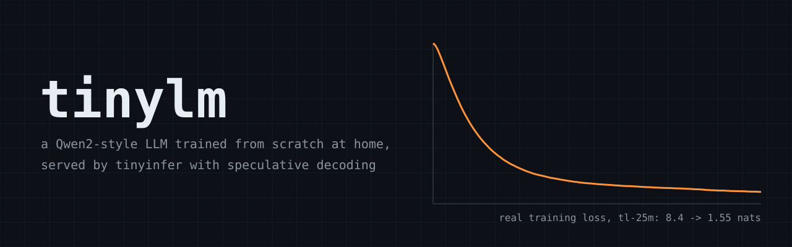
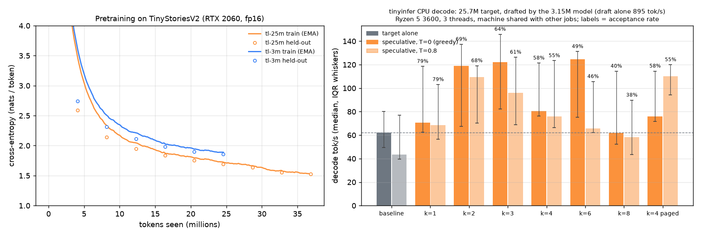
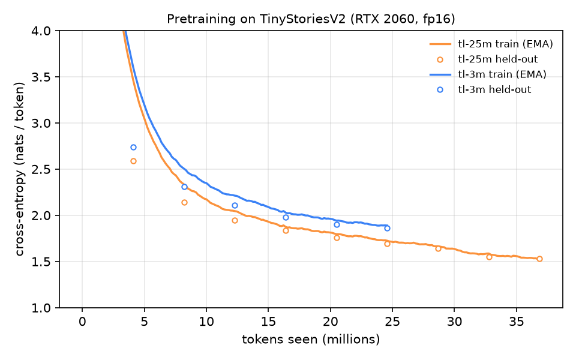
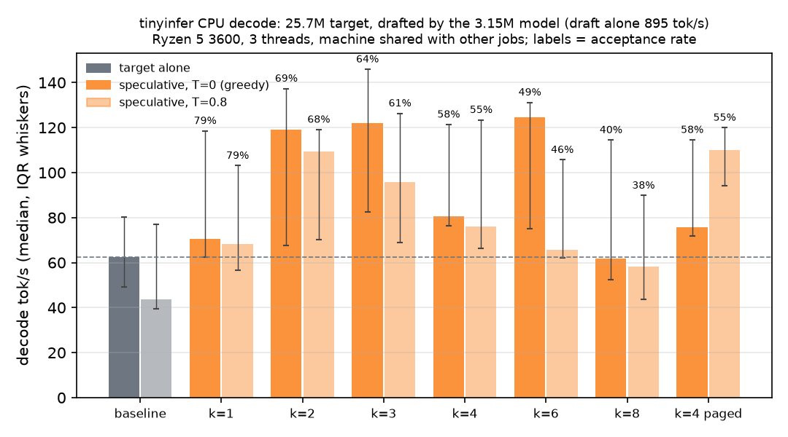

<p align="center">
  
</p>

<p align="center">
  <a href="https://github.com/coopersimpson101-debug/tinylm/actions/workflows/ci.yml"></a>
  <a href="https://github.com/coopersimpson101-debug/tinylm/releases/latest"></a>
  <a href="LICENSE"></a>
  
  
  
</p>

**Train your own small language model from scratch, then serve it with an inference engine you also wrote.**
tinylm cleans and deduplicates an open corpus, trains a byte-level BPE tokenizer, pretrains a
Qwen2-architecture decoder with a hand-written optimiser and training loop, evaluates it, and exports a
GGUF that [tinyinfer](https://github.com/coopersimpson101-debug/tinyinfer) runs unmodified, including
with **speculative decoding** and a **paged KV cache**.

<p align="center">
  <a href="#quickstart">Quickstart</a> ·
  <a href="#how-it-works">How it works</a> ·
  <a href="#results">Results</a> ·
  <a href="#hardware-validation--todo-for-the-author">Hardware TODO</a> ·
  <a href="#roadmap">Roadmap</a>
</p>

<p align="center">
  
</p>
<p align="center"><sub>Left: the real training curves of the two models in this repo (RTX 2060, fp16, 2026-11-26).
Right: tinyinfer decode speed on a Ryzen 5 3600 with the 25.7M model alone vs. drafted by the 3.15M model.
Regenerate with <code>python docs/assets/make_figures.py</code> from the logs in <code>results/</code>.</sub></p>

## Highlights

- **Everything that matters is hand-written:** pre-tokeniser, BPE trainer, MinHash/LSH dedup, the
  Qwen2 model (RMSNorm, NeoX RoPE, GQA, SwiGLU, QKV bias, tied embeddings), AdamW, cosine schedule,
  clipping, fp16 loss scaling, data loader, eval tasks and the GGUF writer. PyTorch supplies tensors and autograd.
- **A real model, really trained:** a 25.7M-parameter model reached **4.64 perplexity** on the full held-out
  TinyStoriesV2 validation split (5.47M tokens) after 36.9M training tokens and 84 minutes on an RTX 2060.
- **Zero-shot evaluation:** 62.4 % (78.4 % length-normalised) on a 500-item, 4-way story-ending
  task built from held-out stories (chance 25 %), and 99.5 % on 204 templated grammar minimal pairs.
- **tinyinfer runs it unmodified:** the PyTorch logits and tinyinfer's C engine agree to
  **7.6e-6** (max |diff|, logit std 2.7) on the trained model, and tinyinfer's C tokenizer reproduces
  tinylm's token ids exactly.
- **Speculative decoding, measured:** drafting with the 3.15M model gives **≈ 2× decode speed** in tinyinfer
  on a Ryzen 5 3600: 1.9–2.0× (median) at greedy with k = 2, 3 or 6, with output identical token for token,
  and 2.2–2.5× at temperature 0.8 with k = 2–3. The machine was shared, so individual runs are noisy (see [Results](#results)).
- **Tested:** 34 pytest cases, including the pre-tokeniser against the real Qwen2 regex, the fast BPE trainer
  against a textbook one, AdamW against `torch.optim.AdamW`, bit-exact checkpoint resume, 2-process
  gloo data parallelism, and logits parity with tinyinfer's NumPy reference and C engine.

## Status

| | what | where it was checked |
|---|---|---|
| ✅ | Data pipeline on a 1 GB TinyStoriesV2 prefix: clean, exact + near dedup, BPE, 243M-token shards | Windows 10, Ryzen 5 3600, 8 worker processes, 156 s |
| ✅ | tl-25m (25.7M) and tl-3m (3.15M) trained, evaluated, exported to GGUF | RTX 2060 (fp16 autocast + hand-written loss scaling) |
| ✅ | PyTorch vs tinyinfer logits parity (NumPy reference and C engine), tokenizer parity | here, on the trained tl-25m and on random models in the test-suite |
| ✅ | Speculative decoding and paged KV cache in tinyinfer, tok/s with/without | Ryzen 5 3600 (tinyinfer branch `feat/spec-decode-paged-kv`) |
| ✅ | Data-parallel `grad_sync` hook == single-process gradient accumulation | 2 processes, gloo, CPU (test-suite) |
| ⏳ | Training on the Ryzen CPU | attempted: the CPU was saturated by other jobs (see [notes](#notes-on-this-run)); both runs moved to the GPU |
| ⏳ | tl-125m / tl-300m on FineWeb-Edu | needs days of GPU time: exact commands and compute estimates [below](#hardware-validation--todo-for-the-author) |
| ⏳ | FineWeb-Edu parquet path (`download.py fineweb-edu-10bt`) | written, not run here (each shard is a large download and needs `pyarrow`) |

## Quickstart

```bash
pip install -e ".[dev]"                     # numpy + torch (CPU or CUDA build), pytest, regex, matplotlib
python -m tinylm.download tinystories --out data/raw --max-mb 1000
python -m tinylm.prepare --train data/raw/tinystories-train.txt --train-truncated --valid data/raw/tinystories-valid.txt --out data/ts4k
python -m tinylm.train --data data/ts4k --out runs/tl-25m --model tl-25m --batch-size 16 --grad-accum 2 --max-steps 2250
python -m tinylm.export runs/tl-25m/model.pt data/ts4k/tokenizer.json -o tl-25m.gguf   # then: tinyinfer -m tl-25m.gguf
```

`scripts/reproduce.sh` runs every step behind the results below (both models, evaluation, export and the
tinyinfer benchmark). `python -m tinylm.evaluate runs/tl-25m/model.pt --data data/ts4k` prints
perplexity, task scores and samples; `python -m pytest -q tests` runs the test-suite (the parity tests use a
tinyinfer checkout at `../tinyinfer` or `$TINYINFER_DIR` and skip without one).

## How it works

```mermaid
flowchart LR
    HF[(Hugging Face Hub<br/>TinyStoriesV2, CDLA-Sharing-1.0)] -->|HTTP Range, SHA-256 logged| RAW[raw text]
    RAW --> CL[clean.py<br/>NFKC + folding<br/>quality heuristics]
    CL --> DD[dedup.py<br/>BLAKE2b exact<br/>MinHash + LSH near]
    DD --> BPE[pretok.py + bpe.py<br/>byte-level BPE trainer]
    DD --> ENC[encode, + EOS]
    BPE --> ENC
    ENC --> SH[(uint16 shards)]
    SH --> TR[train.py<br/>AdamW, cosine, clip,<br/>fp16 loss scale, accum,<br/>ckpt/resume, grad_sync]
    TR --> M[model.py<br/>Qwen2 decoder]
    M --> EV[evaluate.py + tasks.py<br/>ppl, story cloze, grammar]
    M --> EX[export.py + gguf.py]
    EX --> G[(model.gguf<br/>qwen2 tensors + tokenizer)]
    G --> TI[tinyinfer C engine<br/>paged KV, speculative decoding]
```



### Data: cleaning and deduplication

`download.py` takes a byte-range prefix of the 2.2 GB `TinyStoriesV2-GPT4-train.txt` plus the full
validation file and records URL, byte range, SHA-256 and licence in `SOURCES.json`
([copy](results/data_sources.json)). `clean.normalize` applies NFKC, folds typographic quotes and dashes to
ASCII, strips control and zero-width characters and normalises whitespace. `clean.quality_check` drops a
document at the first failed rule: length (≥ 100 chars and ≥ 20 words), ≥ 70 % letters, mean word length
in [2.5, 10], English (≥ 15 % function words, ≤ 1 % non-ASCII), repetition (≤ 30 % duplicate lines, top
word-trigram ≤ 20 % of trigrams), and no leftover markup, in the spirit of the Gopher and C4 rules
[[Rae et al. 2021](https://arxiv.org/abs/2112.11446); [Raffel et al. 2020](https://arxiv.org/abs/1910.10683)].

**Exact duplicates** are found with a 64-bit BLAKE2b digest of the lower-cased, whitespace-collapsed text.
**Near duplicates** use MinHash [[Broder 1997](https://doi.org/10.1109/SEQUEN.1997.666900)]: a document is
the set of its word 5-gram shingles, and for a random hash `h`,
`P[min h(A) = min h(B)] = J(A, B) = |A∩B| / |A∪B|`, so the fraction of equal slots in two 64-hash
signatures estimates the Jaccard similarity. The hash family is multiply-shift,
`h_i(x) = ((a_i x + b_i) mod 2^64) >> 32` with odd `a_i`, vectorised in NumPy. LSH banding splits the
signature into `b = 16` bands of `r = 4` rows; two documents become candidates when any band matches,
which happens with probability `1 − (1 − J^r)^b` (an S-curve with its threshold near `(1/b)^(1/r) = 0.5`).
Candidates are verified with the full signature (estimated `J ≥ 0.8`), clustered with union-find, and all
but the earliest member of each cluster are dropped
[[Leskovec, Rajaraman & Ullman, ch. 3](http://www.mmds.org/)]. Validation documents that exactly match a
training document are removed as well.

### Tokenizer: byte-level BPE

`pretok.py` is a direct matcher for the Qwen2 / GPT-4 pre-tokenisation pattern
`(?i:'s|'t|'re|'ve|'m|'ll|'d)|[^\r\n\p{L}\p{N}]?\p{L}+|\p{N}| ?[^\s\p{L}\p{N}]+[\r\n]*|\s*[\r\n]+|\s+(?!\S)|\s+`,
trying the alternatives in order at each position exactly as a backtracking engine would, with Unicode
categories from `unicodedata`. It is tested against the real regex (via the `regex` package) on fixed samples
and 3,000 random strings; a stdlib-`re` fast path for ASCII text is tested to agree with it.

`bpe.train` is byte-level BPE [[Sennrich et al. 2016](https://arxiv.org/abs/1508.07909);
[Radford et al. 2019](https://cdn.openai.com/better-language-models/language_models_are_unsupervised_multitask_learners.pdf)]:
count pre-tokens, write each as bytes, repeatedly merge the most frequent adjacent pair. A textbook trainer
recounts every pair after every merge; this one keeps pair counts incrementally with an index
`pair → {words containing it}` (only words containing the merged pair are touched) and a max-heap with lazy
deletion, with deterministic tie-breaking. A test checks it produces exactly the same merges as the
textbook algorithm. Tokens are stored as GPT-2 `bytes_to_unicode` strings and merges as `"a b"`, which is
the format of `tokenizer.ggml.tokens` / `tokenizer.ggml.merges` in GGUF.

### Model: a Qwen2 decoder from tensor primitives

```
x ─┬─ RMSNorm ─ Wq·+bq ─ RoPE ─┐
   │          ─ Wk·+bk ─ RoPE ─┼─ softmax(q kᵀ/√d + causal mask) v ─ Wo ─(+)─ h
   │          ─ Wv·+bv ────────┘   (GQA: query head h reads kv head ⌊h·H_kv/H⌋)
   └──────────────────────────────────────────────────────────────────┘
h ─┬─ RMSNorm ─ Wgate ─ SiLU ─(×)─ Wdown ─(+)─ x'        logits = RMSNorm(x_L) · Eᵀ (tied)
   │          ─ Wup ──────────┘            │
   └───────────────────────────────────────┘
```

* **RMSNorm** [[Zhang & Sennrich 2019](https://arxiv.org/abs/1910.07467)]: `y = x / sqrt(mean(x²) + ε) · g`, computed in fp32.
* **RoPE** [[Su et al. 2021](https://arxiv.org/abs/2104.09864)] in the rotate-half (GPT-NeoX) layout: the pair
  `(x_i, x_{i+d/2})` is rotated by `p · θ^(−2i/d)`. The score `⟨R_p q, R_s k⟩` depends only on `p − s`
  (tested). This is the layout tinyinfer and llama.cpp apply for `qwen2`, so Q/K weights export unpermuted.
* **GQA** [[Ainslie et al. 2023](https://arxiv.org/abs/2305.13245)]: `H_kv < H` key/value heads, each shared by
  `H / H_kv` query heads (tested equal to MHA with repeated K/V weights).
* **SwiGLU** [[Shazeer 2020](https://arxiv.org/abs/2002.05202)], bias on Q/K/V only, tied input/output embeddings.
* Attention is the explicit `softmax(QKᵀ/√d + M)V`, not `scaled_dot_product_attention`. GPT-2 init:
  `N(0, 0.02)`, residual output projections scaled by `1/√(2L)`.

| config | params | dim | layers | heads / kv | ffn | vocab | ctx | trained here |
|---|---:|---:|---:|---:|---:|---:|---:|---|
| `smoke` | 0.12M | 64 | 2 | 4 / 2 | 160 | 512 | 128 | tests only |
| `tl-3m` | 3.15M | 192 | 6 | 6 / 2 | 512 | 4096 | 512 | ✅ draft model |
| `tl-10m` | 10.4M | 320 | 8 | 8 / 4 | 864 | 4096 | 512 | – |
| `tl-25m` | 25.7M | 512 | 8 | 8 / 4 | 1408 | 4096 | 512 | ✅ target model |
| `tl-125m` | 125.5M | 768 | 12 | 12 / 4 | 2944 | 32768 | 1024 | ⏳ |
| `tl-300m` | 304.2M | 1024 | 24 | 16 / 4 | 2816 | 32768 | 1024 | ⏳ |

(`ModelConfig.n_params()` is tested equal to the number of allocated parameters.)

### Training

* **AdamW** [[Kingma & Ba 2015](https://arxiv.org/abs/1412.6980); [Loshchilov & Hutter 2019](https://arxiv.org/abs/1711.05101)]:
  `θ ← θ(1 − ηλ)`, `m ← β₁m + (1−β₁)g`, `v ← β₂v + (1−β₂)g²`, `θ ← θ − η m̂ / (√v̂ + ε)` with
  `m̂ = m/(1−β₁ᵗ)`, `v̂ = v/(1−β₂ᵗ)`; β = (0.9, 0.95), λ = 0.1 on matrices only (not norms, biases or
  embeddings). Written with multi-tensor `torch._foreach_*` primitives (one kernel launch per op per group)
  and tested against `torch.optim.AdamW`.
* **Schedule:** linear warm-up then cosine, `η(s) = η_min + ½(η_max − η_min)(1 + cos(π (s−W)/(S−W)))`.
* **Global-norm clipping** at 1.0: `g ← g · min(1, c/‖g‖₂)`.
* **Mixed precision:** fp16 autocast on CUDA (the RTX 2060 has no bf16), bf16 where supported, fp32 on
  CPU. Hand-written dynamic loss scaling [[Micikevicius et al. 2018](https://arxiv.org/abs/1710.03740)]:
  multiply the loss by `S`, unscale the gradients, skip the step and halve `S` on inf/NaN, double `S`
  after 1000 clean steps.
* **Gradient accumulation**, **atomic checkpoints with exact resume** (the sampler is a pure function of
  `(seed, rank, world, step)`, so a resumed run is bit-identical to an uninterrupted one; tested), held-out
  evaluation every 250 steps, JSONL metrics, optional wall-clock limit.
* **Data-parallel ready:** `train_step(model, opt, scaler, micro_batches, lr, clip, amp_ctx, grad_sync)` is a
  plain function; `grad_sync` runs between backward and the optimiser step. Under `torchrun`
  `allreduce_grad_sync` averages gradients with `torch.distributed`; a 2-process gloo test checks it
  equals single-process accumulation. An external driver (e.g. a ring all-reduce) can pass its own hook.

### Evaluation

* **Perplexity** `exp(mean NLL)` over non-overlapping 512-token windows of the full TinyStoriesV2 *valid*
  split (never trained on).
* **Story cloze** (HellaSwag-style [[Zellers et al. 2019](https://arxiv.org/abs/1905.07830)]): 500 held-out
  validation stories; context = the story without its last sentence, choices = the true last sentence and
  the last sentences of three other random validation stories. Scored by `Σ log p(ending | context)` (acc)
  and per-character log-probability (acc_norm). Chance = 25 %. This is our own construction, not a standard benchmark.
* **Grammar minimal pairs** (BLiMP-style [[Warstadt et al. 2020](https://arxiv.org/abs/1912.00582)]): 204
  templated pairs (subject–verb agreement, a/an, pronoun gender, past tense, reflexives); the model must give
  the grammatical sentence the higher probability. Chance = 50 %. The templates are simple, so this is a
  sanity check rather than a hard benchmark.

### Export and serving

`export.py` writes GGUF v3 by hand (`gguf.py`) with llama.cpp's Qwen2 tensor names and metadata
(`qwen2.*` hyper-parameters, `tokenizer.ggml.model = gpt2`, `pre = qwen2`, tokens, token types, merges,
EOS id), F32 or F16. tinyinfer loads it with no changes; its re-quantiser (`tinyinfer-quantize`) can then
produce Q8_0 / Q4_0. Speculative decoding and the paged KV cache are implemented in tinyinfer
(branch `feat/spec-decode-paged-kv`); the maths and the exactness argument are in
[tinyinfer's README](https://github.com/coopersimpson101-debug/tinyinfer#paged-kv-cache-and-speculative-decoding).

## Results

All numbers below come from the logs in [`results/`](results); machine: Windows 10, AMD Ryzen 5 3600
(6C/12T), NVIDIA RTX 2060 6 GB, PyTorch 2.14.1+cu126, 2026-11-26. Other jobs were sharing the machine
throughout (CPU at 100 % load, and another process on the GPU for part of the run), so throughput numbers
are lower bounds for this hardware.

### Data pipeline ([`results/data_report.json`](results/data_report.json))

| | train (1 GB prefix) | valid (full split) |
|---|---:|---:|
| documents in | 1,220,482 | 27,631 |
| dropped by heuristics | 110 (length 101, english 7, repetition 2) | 2 (length 1, repetition 1) |
| exact duplicates | 0 | 0 |
| near duplicates (J ≥ 0.8) | 0 of 2,244 LSH candidates | 0 of 4 candidates |
| exact overlap with train | – | 0 |
| tokens (vocab 4096) | 243,301,065 in 8 shards | 5,471,746 |

TinyStoriesV2 turns out to be very clean: the generator produced no exact or ≥ 0.8-Jaccard duplicates in
this prefix (the LSH stage did flag 2,244 candidate pairs, all below the threshold on verification). The
dedup code itself is tested on planted near-duplicates. BPE training on 99.6 MB (22,509 distinct pre-tokens)
took 3.2 s; the whole pipeline took 156 s with 8 processes. The tokenizer averages ≈ 4.1 characters per token.

### Training ([`results/train_tl-25m.jsonl`](results/train_tl-25m.jsonl), [`results/train_tl-3m.jsonl`](results/train_tl-3m.jsonl))

<p align="center"></p>

| | tl-25m (target) | tl-3m (draft) |
|---|---:|---:|
| parameters | 25,707,008 | 3,150,144 |
| hardware / precision | RTX 2060, fp16 + loss scaling | RTX 2060, fp16 + loss scaling |
| steps × tokens/step | 2,250 × 16,384 | 1,500 × 16,384 |
| tokens seen | 36.9M | 24.6M |
| training time | 84.4 min (4 segments, see notes) | 7.8 min |
| median throughput | 12.0k tok/s (range 0.9k–20.4k under contention) | 54k tok/s |
| peak LR / final LR | 1e-3 / 1e-4 | 2e-3 / 2e-4 |
| held-out loss, first eval (4.1M tokens) | 2.588 | 2.743 |
| held-out loss, final (40 × 16 × 512 tokens) | 1.528 | 1.861 |

### Evaluation ([`results/eval_tl-25m.json`](results/eval_tl-25m.json), [`results/eval_tl-3m.json`](results/eval_tl-3m.json))

| | tl-25m | tl-3m | chance |
|---|---:|---:|---:|
| perplexity, full valid split (5,471,744 tokens) | **4.644** | 6.490 | – |
| story cloze, 500 items: acc / acc_norm | **62.4 % / 78.4 %** | 49.0 % / 61.8 % | 25 % |
| grammar minimal pairs (204) | **99.5 %** | 91.2 % | 50 % |

Samples from tl-25m (temperature 0.8, top-k 40, seed 0; unedited, cut at 160 tokens):

> **Once upon a time,** there was a little boy named Tim. Tim loved to play with his toys. One day, Tim found
> a big box of junk in his room. He did not know what was inside. Tim wanted to know what was inside the box.
> Tim opened the box and found a lot of junk. There were balls, dolls, and balls. …

> **Tom found a small box. Inside** the box, he saw a big, furry dog. The dog was trying to walk and play, but
> Tom knew he should not go in. He was very scared, but he listened to his mom and dad. …

Greedy decoding of the exported GGUF in tinyinfer (`--temp 0`):

> Once upon a time, there was a little girl named Lily. She loved to play with her toys and eat yummy food.
> One day, she found a big, red apple in her yard. She was very happy and wanted to eat it all.
> Lily's mom saw her and said, "Lily, you can't eat that apple. It is too big for you." But Lily did not
> listen. …

### PyTorch ↔ tinyinfer parity ([`results/parity_tl-25m.json`](results/parity_tl-25m.json))

On a 46-token passage with the trained tl-25m (logit std 2.73): max |Δlogit| vs tinyinfer's float64 NumPy
reference **8.4e-6**, vs the C engine (AVX2, F32) **7.6e-6**; greedy argmax agreement 100 %; tinyinfer's C
BPE tokenizer produces exactly tinylm's ids.

### Speculative decoding in tinyinfer ([`results/spec_bench.json`](results/spec_bench.json))

<p align="center"></p>

| temperature | configuration | decode tok/s, median (min-max) | speed-up | acceptance | tokens / target call |
|---|---|---:|---:|---:|---:|
| 0 | tl-25m alone | 62.3 (37-106) | 1.00× | - | - |
| 0 | tl-3m alone (draft) | 895.2 (372-1787) | - | - | - |
| 0 | spec k=1 | 70.6 (44-123) | 1.13× | 78.6 % | 1.78 |
| 0 | spec k=2 | 119.1 (50-153) | 1.91× | 69.2 % | 2.38 |
| 0 | spec k=3 | 122.1 (72-164) | 1.96× | 64.0 % | 2.90 |
| 0 | spec k=4 | 80.7 (51-153) | 1.29× | 57.8 % | 3.28 |
| 0 | spec k=6 | 124.6 (53-144) | 2.00× | 49.1 % | 3.89 |
| 0 | spec k=8 | 61.8 (48-145) | 0.99× | 40.0 % | 4.12 |
| 0 | spec k=4 paged | 75.8 (58-151) | 1.22× | 57.8 % | 3.28 |
| 0.8 | tl-25m alone | 43.5 (19-102) | 1.00× | - | - |
| 0.8 | tl-3m alone (draft) | 712.2 (325-1520) | - | - | - |
| 0.8 | spec k=1 | 68.4 (46-118) | 1.57× | 78.6 % | 1.78 |
| 0.8 | spec k=2 | 109.4 (61-158) | 2.51× | 67.9 % | 2.35 |
| 0.8 | spec k=3 | 95.9 (58-157) | 2.20× | 60.8 % | 2.81 |
| 0.8 | spec k=4 | 76.1 (48-162) | 1.75× | 55.1 % | 3.19 |
| 0.8 | spec k=6 | 65.7 (48-121) | 1.51× | 46.0 % | 3.72 |
| 0.8 | spec k=8 | 58.2 (43-105) | 1.34× | 38.1 % | 3.99 |
| 0.8 | spec k=4 paged | 110.1 (59-163) | 2.53× | 55.1 % | 3.19 |

256 new tokens per run, 3 prompts x 3 seeds per configuration, configurations interleaved round-robin, 3 threads, top-k 40, repetition penalty off, `--ignore-eos`; date 2026-11-26.

How to read this. Every speculative run at T = 0 produced exactly the same text as the target alone
(`identical_to_baseline: true` for all 63 greedy speculative runs in the JSON). Acceptance falls with `k`
(79 % at k = 1 to 40 % at k = 8) while tokens per target call rise (1.78 to 4.12), so the useful range is
k = 2–6. The wall-clock numbers are the noisy part: the CPU was at 100 % load from other jobs, so a single
configuration varies by 2–3× between runs (min–max column), and differences between neighbouring `k`
values, and between the paged and contiguous cache, are within that noise. Two load-independent quantities
are exact: tokens per target call and the acceptance rate. A simple cost model, speed-up ≈
`tokens_per_call / (1 + k·c)` with `c` = draft/target cost per token = 62.3 / 895.2 ≈ 0.07 (from the
"alone" rows), predicts 2.4× (k = 3), 2.6× (k = 4) and 2.7× (k = 6) as an upper bound (it treats a
batched verification of k + 1 tokens as costing one decode step). In one earlier pair of greedy runs
(200 tokens, 6 threads, not part of the JSON) the target decoded at 102 tok/s alone and 215 tok/s with k = 4,
in line with the ≈ 2× medians. A cheaper draft relative to its target lowers `c`; larger target/draft pairs are not measured here.

### Notes on this run

* **Why the GPU and not the Ryzen CPU.** The plan was a bounded CPU run. During this session the CPU was
  pinned at 100 % by other jobs; a 13-step training micro-benchmark of tl-3m on 4 threads did not finish
  within 200 s (< 300 tok/s), so both models were trained on the RTX 2060 instead. CPU training works
  (the test-suite trains the `smoke` config on the CPU and checks loss and exact resume) but no CPU
  training numbers are reported here.
* **tl-25m was trained in four segments** (`resume_from_step` lines in its log) while the machine was being
  shared: steps 0–500 under a planned 5,000-step cosine, 500–1,750 under 3,300, then 1,750–2,250 under a
  2,250-step schedule so the learning rate could decay to its minimum within the time budget. The LR therefore
  has two small discontinuities (visible in the `lr` column); each resume reloaded the exact optimiser and
  loss-scaler state. The final model is the end of the last segment.
* Throughput varied from 0.9k to 20.4k tok/s with the machine's load. The dips coincide with (a) briefly
  running the draft on the same 6 GB card (most likely spilling into shared memory; it was stopped and run
  afterwards) and (b) CPU starvation of the Python kernel-launch loop. Restarting at step 1,250 with the
  multi-tensor (`_foreach`) optimiser coincided with a jump from ≈ 4–6k to ≈ 17–20k tok/s, but the load
  changed too, so that is not a controlled measurement.

## Hardware validation / TODO for the author

The 125M / 300M runs need a real GPU budget. Commands (FineWeb-Edu sample, ODC-By 1.0; needs
`pip install pyarrow`; each parquet shard is a large download):

```bash
python -m tinylm.download fineweb-edu-10bt --out data/raw --max-mb 0       # 2 parquet shards -> text
python -m tinylm.prepare --train data/raw/fineweb-edu-10bt-train.txt --valid data/raw/fineweb-edu-10bt-valid.txt \
    --out data/fw32k --vocab 32768 --tok-mb 500
python -m tinylm.train --data data/fw32k --out runs/tl-125m --model tl-125m --seq-len 1024 \
    --batch-size 8 --grad-accum 64 --max-steps 4800 --warmup 300 --lr 6e-4 --min-lr 6e-5   # 2.5B tokens
python -m tinylm.train --data data/fw32k --out runs/tl-300m --model tl-300m --seq-len 1024 \
    --batch-size 4 --grad-accum 128 --max-steps 11500 --warmup 500 --lr 3e-4 --min-lr 3e-5 # 6.0B tokens
torchrun --nproc_per_node 2 -m tinylm.train ...                                         # multi-GPU, same flags
```

Expected compute (arithmetic, not measured): training FLOPs ≈ `6N + 12·L·T·d` per token
(`ModelConfig.flops_per_token`): 0.87 GFLOP for tl-125m, 2.13 GFLOP for tl-300m at T = 1024. At the ≈ 20
tokens/parameter "Chinchilla" budget [[Hoffmann et al. 2022](https://arxiv.org/abs/2203.15556)] that is
2.2e18 FLOPs (2.5B tokens) and 1.3e19 FLOPs (6B tokens). The tl-25m run sustained ≈ 3.2 TFLOP/s on the
RTX 2060 (179 MFLOP/token × ≈ 18k tok/s when the GPU was not shared), which would mean ≈ 8 days for tl-125m
and ≈ 46 days for tl-300m; a 24 GB-class GPU at ≈ 40 TFLOP/s effective brings these to ≈ 15 h and ≈ 4 days.
The explicit attention matrix is memory-hungry at T = 1024, so on a 6 GB card use micro-batch 1–2 with
gradient accumulation.

| run | GPU | tokens | wall-clock | final valid ppl | story cloze acc_norm | grammar | status |
|---|---|---:|---:|---:|---:|---:|---|
| tl-125m on FineWeb-Edu | | | | | | | ⏳ |
| tl-300m on FineWeb-Edu | | | | | | | ⏳ |
| tl-25m CPU-only run (Ryzen 5 3600, idle machine) | – | | | | | | ⏳ |

For FineWeb-Edu models the story-cloze task is out of domain; add a standard benchmark (e.g. HellaSwag
through the same `continuation_logprob` scorer) before comparing.

## Roadmap

- [x] Data pipeline, BPE, Qwen2 model, training loop, evaluation, GGUF export, tinyinfer parity.
- [x] Speculative decoding + paged KV cache in tinyinfer, measured with these models.
- [ ] tl-125m / tl-300m runs on FineWeb-Edu (see above), and HellaSwag / ARC-Easy scoring.
- [ ] Fused / memory-efficient attention kernel (FlashAttention-style tiling written by hand) to fit
      longer contexts on small GPUs.
- [ ] Drive `train_step` from the sibling ringtrain repo's ring all-reduce over several home machines.
- [ ] Distil the draft from the target (instead of training it independently) to raise acceptance.
- [ ] Q8_0 export directly from tinylm and a quantisation-aware evaluation.

## Repository layout

```
tinylm/            download, clean, dedup, pretok, bpe, shards, prepare, config, model, optim,
                   train, tasks, evaluate, gguf, export
tests/             pytest suite (data, model + optimiser + training, export + parity)
scripts/           reproduce.sh, bench_spec.py (tinyinfer tok/s), parity.py
results/           every log and JSON the README quotes (training metrics, eval, parity, bench, data report)
docs/assets/       make_figures.py (figures + banner from results/), generated images
```

## License

MIT, see [LICENSE](LICENSE). The TinyStories dataset is CDLA-Sharing-1.0 (Eldan & Li 2023,
[arXiv:2305.07759](https://arxiv.org/abs/2305.07759)); no dataset text or model weights are committed to
this repository, apart from the trained tokenizer (`results/tokenizer_ts4k.json`) and the short samples quoted above.
